<h1 align="center">BeVe-VAE</h1>

<p align="center">
  <b>Variational Autoencoders · Latent Representations · Intervention</b>
</p>

<p align="center">
  OMS4 Part 1<br>
  BeVe-VAE and comparisons with VAE, β-VAE, and VO-VAE on 3D Shapes.
</p>

<p align="center">
  <a href="#-model-overview">Model Overview</a> ·
  <a href="#-setup">Setup</a> ·
  <a href="#-dataset">Dataset</a> ·
  <a href="#-train--test">Train &amp; Test</a> ·
  <a href="#-results">Results</a>
</p>

---

## 🧠 Model Overview

**BeVe-VAE** combines β-weighted VAE training with an orthogonality loss on learned vector representations of latent means. This repository compares BeVe-VAE with VAE, β-VAE, and VO-VAE through image reconstruction and latent intervention.

BeVe-VAE is implemented under the name `betavo_vae` (β-VO-VAE) in configuration and output filenames. Use `betavo_vae.3dshapes` to run BeVe-VAE.

| Model | Configuration name | β | Orthogonality coefficient |
| :--- | :--- | :---: | :---: |
| **VAE** | `vae.3dshapes` | 1.0 | — |
| **β-VAE** | `beta_vae.3dshapes` | 6.0 | — |
| **VO-VAE** | `vo_vae.3dshapes` | 1.0 | 0.1 |
| **BeVe-VAE (Ours)** | `betavo_vae.3dshapes` | 6.0 | 0.1 |

The provided configurations use **64 × 64 RGB images** and **6 latent dimensions**. VO-VAE and BeVe-VAE use 128-dimensional latent vector representations.

## 🛠️ Setup

### Environment

- **Python 3.12.4**
- Package versions are specified in [`requirements.txt`](requirements.txt).

### 1. Clone the repository

```bash
git clone https://github.com/drawcodeboy/BeVe-VAE.git
cd BeVe-VAE
```

### 2. Create a Python environment

Using Python 3.12.4, run:

```bash
python3 -m venv .venv
source .venv/bin/activate
pip install -r requirements.txt
```

On Windows, activate the environment with `.venv\Scripts\activate`.

## 📁 Dataset

Place the **3D Shapes** HDF5 file at `data/3dshapes.h5`, then run the conversion script from the repository root:

```bash
python subtasks/data_save/exec.py
```

The script selects **10,000 samples** by default using seed `42` and saves each image and label as a NumPy file. Adjust `data_num` in the script to change the sample count.

```text
data/
├── 3dshapes.h5
└── 3dshapes/
    ├── images/
    │   ├── 000001.npy
    │   └── ...
    └── labels/
        ├── 000001.npy
        └── ...
```

The dataset loader uses a **70% / 10% / 20%** train / validation / test split and scales image values to `[0, 1]`.

## 🚀 Train & Test

Use a configuration name from the model table **without the `.yaml` extension**. Training configurations are in [`configs/train/`](configs/train/), and test configurations are in [`configs/test/`](configs/test/).

```bash
# Train
python train.py --config=betavo_vae.3dshapes

# Test
python test.py --config=betavo_vae.3dshapes
```

Before running, review these settings in the corresponding YAML files:

| Setting | Description |
| :--- | :--- |
| `device` | Defaults to `cuda:0`; set it to match your environment. Training and testing fall back to CPU when CUDA is unavailable. |
| `data` → `root` | Points to the converted dataset at `data/3dshapes`. |
| `save.weights_path` | Directory for model checkpoints; defaults to `saved/weights`. |
| `save.weights_filename` | Test checkpoint filename. Set this to an existing checkpoint from training. |

Training saves a model checkpoint when validation loss improves, so a checkpoint for epoch 100 is not guaranteed. Training losses are saved under `saved/loss` by default.

### Generate reconstruction and intervention images

The visualization script uses the test configuration and its checkpoint settings:

```bash
python subtasks/intervention/exec.py --config=betavo_vae.3dshapes
```

Additional data processing and visualization utilities are described in [`subtasks/README.md`](subtasks/README.md).

## 📊 Results

### Reconstruction

Saved ground-truth and reconstruction examples for each model:

| Model | Ground Truth | Reconstruction |
| :---: | :---: | :---: |
| **VAE** |  | 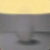 |
| **β-VAE** |  | 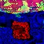 |
| **VO-VAE** |  | 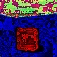 |
| **BeVe-VAE (Ours)** | 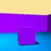 | 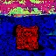 |

### Latent Intervention

Saved outputs after modifying a latent variable:

| VAE | β-VAE | VO-VAE | BeVe-VAE (Ours) |
| :---: | :---: | :---: | :---: |
| 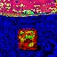 | 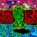 | 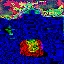 | 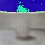 |

<details>
<summary><b>View smoothed intervention images</b></summary>

These images apply blur as a visualization postprocessing step.

| VAE | β-VAE | VO-VAE | BeVe-VAE (Ours) |
| :---: | :---: | :---: | :---: |
| 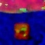 | 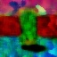 | 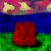 | 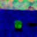 |

</details>
